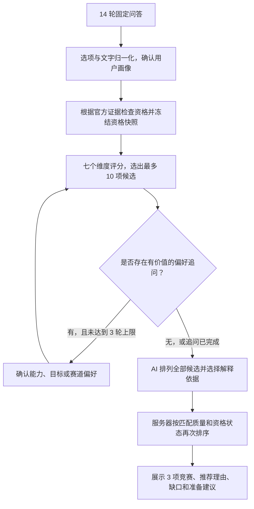

# 赛途 Campus 竞赛助手推荐机制

## 当前工作目录的实现（2026 年 11 月 5 日）

乐乐的首题是「你最希望这次参赛帮你得到什么？」。本科低年级新手可以从课程作业、实验或社团分工说起。系统记录本人承担的角色和实际产出，结合想做及拒绝的任务、资源和主要目标来评估竞赛。

### 学生如何回答

快速问答经过目标、学段、专业、兴趣、能力、经历、任务、每周时间与资源九个主题。深入模式额外判断是否需要了解成果和项目起点，并询问队伍及参与方式。学段用于当前身份的资格核验，其他未知项可跳过。学生可以明确某种资源有机会争取，也可以说明确定无法获得。若必须保持现有队伍，须主动勾选这一限制。

页面先收集草稿。确认及同意后，服务端核对选项，对有歧义的自由文字返回待确认解释。最多三轮偏好追问针对候选之间仍有意义的取舍。学生可以返回修改回答，修改后用新的确认结果重新计算，不延用旧推荐。

### 怎样得出结果

- 在整个目录比较可行的竞赛系列及赛道。只有已确认且有规则支持的资格冲突，或学生明确的限制，才构成相应排除依据；信息不足需要标注并核对。
- 长期适配综合目标、实际任务、经历、准备条件和成长空间。未知维度保留不确定区间。涉及综测、评奖或推免时不猜测本校政策。截止、开放状态、赛事日期和查询时间不参与适配选择和排名。
- 顶部最多展示三个不同系列的可靠建议，允许两项、一项或空结果。卡片说明推荐赛道、学生哪项经历有用、准备条件和官方依据。报名状态单独展示；过往届次不可当作下一届的承诺。
- 更多候选、候选对比、为什么没推荐和修改后重算均从本次结果进入。用户主动保存后，「我的竞赛」保留当时的判断及赛道。老数据未记录赛道时会标注，赛道变动时以保存时的描述为准。联系方式出现在完整结果之后。

### 当前协议和验证

公共问卷仍使用 `competition-questionnaire.v1`，仅提交学生已回答的字段及可选 `decisionContext`，并能读取旧版完整包。服务端确认画像仍采用 `competition-profile.v5`。结果协议 `competition-recommendation.v5` 可返回 `matched` 或 `no_match`。新结果的 `rankingSource` 为 `evidence-rules`。采用 `2026-11-05.v7` 同意说明后，可将固定候选的临时编号与已确认条件形成的解释短句提交给 DeepSeek，由它在站内依据中选一至两条。资格、名单及顺序始终由服务端决定。无可用模型时展示原规则解释。旧收藏保留历史排序来源和评分口径，系统不会回写一个推测的赛道。

回归检查涵盖快速与深入模式、未知条件、日期不变性、资格冲突、多个赛道、空结果、只推荐一至两项及旧收藏兼容。工程通过情况与独立专家评价、真实学生使用效果分别记录。

---

<details>
<summary>历史实现 · 2026 年 11 月 2 日固定问卷与模型排序快照</summary>

以下内容完整保留旧版计算和验证口径，用于阅读历史记录。当时的十四题、先取十项、模型重排、固定三项及评分权重均不描述上方新版入口。

# 赛途 Campus 竞赛助手推荐机制说明

整理日期：2026 年 11 月 2 日。

本文说明当前本地项目中竞赛助手如何把用户回答转化为竞赛推荐，包括信息收集、资格筛选、评分、动态追问、AI 排序和最终结果展示。适用范围是本项目 2026 年 11 月 2 日的历史本地快照，不代表当前实现或线上部署版本。

核心机制是：**将已确认的用户画像与本地竞赛目录匹配，先检查资格、再按规则评分，通过偏好追问细化候选，让 AI 排序并选择解释依据，最后由服务器规则选出 3 项不同竞赛。**

## 1. 整体推荐流程



固定问卷结束后，如果没有值得自动追问的问题，系统可以提供一次可跳过的目标偏好题。追问只细化偏好，不改变已经确认的学籍、队伍等资格事实。

当前关键版本：

| 模块 | 版本 |
|---|---|
| 竞赛目录 | `2026-08-25.v6` |
| 用户画像 | `competition-profile.v5` |
| 固定问卷协议 | `competition-questionnaire.v1` |
| 确定性评分器 | `deterministic-2026-08.v14` |
| 动态追问策略 | `deterministic-preference-policy.v1` |
| 动态追问版本 | `competition-clarify.v8` |
| AI 排序提示词 | `competition-rank.v4` |

## 2. 推荐所依据的竞赛数据

推荐范围来自项目内置的 **100 项不同竞赛**。每项竞赛具有结构化信息，供资格判断和匹配计算使用。

| 信息类别 | 主要内容 |
|---|---|
| 赛事身份 | 名称、别名、主办信息、官方来源、分类和方向 |
| 资格条件 | 学段、学籍、人数、同校要求、必需资源、部分赛事的入学年份条件 |
| 匹配标签 | 专业、具体学科、技能、兴趣、任务形式、成果类型 |
| 备赛条件 | 难度、适合的经验和项目起点、每周投入、资源支持 |
| 赛道信息 | 赛道名称、赛道任务、赛道对应的资格和匹配标签 |
| 时间与形式 | 报名时间、线上或线下形式、赛程核验时间 |
| 数据依据 | 官方事实引用、资料可信度、完整度和核验提醒 |

系统在推荐时读取这些本地数据，没有实时搜索全网或自动抓取官网更新。库外赛事不会进入候选；推荐质量和报名状态的准确性依赖目录维护。

## 3. 用户信息如何进入推荐系统

### 3.1 固定问卷收集的信息

固定问卷共 14 轮，部分轮次包含多个字段，展开后有 **19 个必需字段**。

| 轮次 | 收集的信息 | 推荐中的作用 |
|---|---|---|
| 1 | 学段、年级和学籍状态 | 判断本科或研究生、全日制、在校等资格 |
| 2 | 专业大类和具体学科 | 判断学科是否对口，并区分细分方向 |
| 3 | 擅长的技能 | 判断编程、数据分析、研究、设计、表达等能力 |
| 4 | 感兴趣的方向 | 衡量任务与个人兴趣是否一致 |
| 5 | 核心任务偏好 | 区分算法、建模、软件、硬件、研究、创业等任务 |
| 6 | 参赛目标 | 区分获奖、升学、就业、创业、项目积累等诉求 |
| 7 | 希望形成的成果 | 匹配论文、软件、原型、商业计划书等交付物 |
| 8 | 当前项目起点 | 判断只有想法、课程基础、已有原型或已验证项目 |
| 9 | 竞赛经历和已有成果证据 | 判断经验以及项目、论文、作品、获奖等基础 |
| 10 | 每周可投入时间 | 判断备赛投入是否可行 |
| 11 | 希望参赛的时间 | 区分近期参赛、下一届备赛或时间灵活 |
| 12 | 组队状态、人数和是否同校或同单位 | 判断团队可行性以及官方组队资格 |
| 13 | 可用资源与报名支持 | 判断导师、实验室、设备、数据等条件 |
| 14 | 参与方式 | 匹配线上、线下或均可的参与偏好 |

首次高等教育年份是额外的可选事实。当前归一化代码在学段回答显式包含该字段，或学段自由文字出现年份时，才加入对应解释和确认流程；不能假定后续偏好追问会自动补齐这一资格信息。

### 3.2 选项和自由文字如何被理解

用户可以选择选项、填写文字，或同时使用两者。

1. 直接选择的选项进入系统白名单字段。
2. 自由文字先通过本地别名和映射规则解释。
3. 本地无法确定映射的文字，再由 AI 尝试映射到已有白名单选项。
4. 固定问卷中所有带自由文字的字段，都需要用户确认后才采用。
5. 出现歧义、无法映射或选项与文字冲突时，由用户确认最终值。

例如，“我会写 Python，做过数据分析”需要映射为技能字段，后续评分使用确认后的结构化值。系统不会把任意原话直接当成可计分的能力证据。

完成确认后，服务器生成 V5 用户画像和问卷凭证。后续推荐使用已确认画像，动态回答进入排序时也只保留确认后的白名单值。

## 4. 资格筛选如何排除不合适的赛事

资格筛选判断的是：**用户是否与有官方证据支持的报名条件存在明确冲突。**

| 条件 | 明确冲突时的处理 |
|---|---|
| 当届赛事已取消 | 有对应官方事实证据时排除 |
| 学段限制 | 用户学段不在允许范围内时排除 |
| 全日制要求 | 用户已确认不满足对应全日制要求时排除 |
| 在校要求 | 用户已毕业，赛事又明确要求在校注册时排除 |
| 必需资源 | 用户已确认缺少官方规定的必需资源时排除 |
| 首次高等教育年份 | 不满足年份门槛，且没有出生年份替代条件或申诉通道时排除 |
| 同校或同单位要求 | 用户明确跨校或跨单位，而官方不允许时排除 |
| 队伍人数 | 用户人数区间与官方允许范围完全不相交时排除 |

硬排除需要针对该项事实的官方依据。某赛事存在一个官方链接，并不意味着它的全部标签都能用于硬排除。

资格结果分为三种：

| 状态 | 含义 | 是否可进入候选 |
|---|---|---|
| `eligible` | 在当前已确认事实和记录规则范围内，资格初筛通过 | 可以 |
| `needs_clarification` | 资格信息或官方规则仍需核验 | 可以，但必须展示待核验原因 |
| `ineligible` | 已确认与官方硬条件冲突 | 排除 |

信息不足不会直接被判定为合格，也不会一律被排除。固定画像确认后，系统冻结资格快照；后续“更喜欢算法”或“更看重获奖”等偏好不能修改学籍、人数等资格事实。

## 5. 基础匹配分如何计算

### 5.1 七个评分维度

系统对未被硬排除的竞赛计算固定权重的基础分，总分为 100 分。

| 评分维度 | 满分 | 主要计算依据 |
|---|---:|---|
| 专业与任务 | 25 | 专业、具体学科、任务形式、兴趣、任务类型与学段针对性 |
| 技能与证据 | 20 | 技能适配占本项 75%，已有项目、论文、作品等证据占 25% |
| 目标与成果 | 15 | 比赛的目标收益，以及用户希望形成的成果 |
| 项目成熟度 | 10 | 参赛经验、当前项目起点与比赛难度的适配程度 |
| 队伍与资源 | 15 | 每周投入、队伍状态和现有资源的可行性 |
| 时间与开放状态 | 10 | 参赛形式与参赛周期的适配程度，各占一半 |
| 数据可信度 | 5 | 目录可信度占本项 50%，完整度占 30%，事实证据覆盖占 20% |
| **合计** | **100** | |

每项匹配比例乘以固定权重，分别保留一位小数后相加。整个维度未知时按零计，不通过提高其他维度的权重来补足。

### 5.2 专业、任务和目标如何影响分数

专业与任务维度包含多层计算：

- 有具体学科信息时，背景部分按 70% 具体学科和 30% 专业大类组合。
- 学科背景与任务意向各占这一中间结果的 50%。
- 任务意向中，兴趣占 15%；其余部分由任务形式决定，有动态能力偏好时进一步细化。
- 当前评分器还以 43% 权重混入代码定义的任务类型匹配，例如算法、软件产品、统计建模或机器人集成。
- 学段规则已知时，再考虑赛事对该学段的针对性。

这里的任务类型匹配由代码规则计算，不需要在评分时调用大模型。

目标收益采用预设权重：获奖为 1.15、升学为 1.1、拓展人脉为 0.85，其余目标为 1。目标与成果维度同时考虑期望交付物；动态追问确认某目标优先后，还会进一步提高该目标对本维度的影响。

### 5.3 跨领域匹配的限制

当用户已确认的核心学科与任务形式均不匹配时：

- 专业与任务分封顶为 7.4 分。
- 技能与证据分、目标与成果分各按原值的 60% 计算。
- 队伍与资源分按原值的 75% 计算。

这些规则保留跨领域能力的参考价值，同时限制缺乏核心匹配的赛事成为强推荐。

## 6. 最多 10 项候选如何产生

系统先按基础分排序，同分时考虑赛程可用性，再使用赛事 ID 保持稳定顺序，然后选出最多 10 项候选。

候选选择还包含以下处理：

- 用户希望本届或三个月内参赛时，先考虑当前或即将开放的赛事，再考虑报名时间待核验的赛事，最后保留已截止赛事作为下一届备赛参考。
- 用户接受下一届或时间灵活时，更侧重匹配程度。
- 最多保护 4 个具体学科匹配项，以及最多 3 个明确能力偏好匹配项；必要时替换候选末尾项目，以保持总数上限。
- 有多个赛道的赛事按赛道评分。未明确选择赛道时，保留评分最高且未被硬排除的赛道；已选择赛道时，只计算该赛道。
- 相同赛事最终去重，不会用同一比赛的三个赛道填充三项推荐。

因此，候选并不永远等于基础分机械最高的十项，也没有每个类别必须推荐一项的固定配额。

赛程按上海时区判断。90 天内开放的赛事进入近期开放范围；核验超过 180 天的赛程标为待复核；报名截止后提示仅供下一届备赛参考。

## 7. 动态追问如何细化推荐

动态追问最多 3 轮，三类问题各最多一次。

| 追问类型 | 典型内容 | 影响 |
|---|---|---|
| 能力偏好 | 更希望证明算法、软件工程、研究或产品验证等哪类能力 | 细化任务适配、候选覆盖和排序 |
| 目标取舍 | 获奖、升学、就业等目标中哪个优先 | 细化目标得分和排序 |
| 赛道偏好 | 更希望参加某比赛的哪个内容赛道 | 确定赛道并重新匹配 |

题目、选项和选择方式由服务器规则生成。服务器先模拟合法答案，再运行全目录候选选择和最终三项选择，比较不同答案是否会改变推荐成员、顺序或赛道。

至少出现两种不同结果，问题才会被视为值得自动追问。系统优先选择能够区分更多结果的问题；并列时按能力、目标、赛道的顺序选择。无有价值的问题或达到轮数上限时停止。

动态追问用于偏好细化，不能补充或覆盖固定问卷中的资格事实。它比较的是本地规则生成的结果，不是反复调用 AI 来测试答案。

## 8. AI 在推荐中具体负责什么

### 8.1 AI 接收的信息

最终排序环节向模型提供：

- 已确认的 V5 用户画像及学科意图。
- 已确认的动态偏好选项。
- 最多 10 项候选赛事及其结构化标签。
- 每项赛事的基础分、分项分数、资格状态、报名状态和推荐赛道。
- 服务器整理好的匹配理由、缺口和准备建议证据目录。

动态回答的原始备注不会直接进入最终排序，保留的是确认后的选项值。

### 8.2 AI 的输出与边界

模型为全部候选提供完整且不重复的排列，并为每项候选选择三类证据编号：匹配理由、可能缺口和准备建议。

服务器验证候选 ID 是否完整唯一，证据是否属于对应赛事、是否属于正确类别，再将证据编号展开成展示文案。模型不能新增库外赛事、改写规则分数、改变资格结论，或任意编造解释依据。

解释会区分官方事实、系统匹配推断、用户已确认信息和准备建议。专业或技能的契合属于系统推断，不等同于官方报名资格。

当前排序提示词为 `competition-rank.v4`。推荐模型按 `AI_COMPETITION_RECOMMEND_MODEL`、通用 `AI_MODEL`、代码默认 `deepseek-v4-pro` 的优先级选择；实际使用值以运行环境为准。

### 8.3 AI 不可用时

缺少配置、网络错误、超时或输出校验失败时，系统保留本地规则候选和服务器解释，并标记为 `rule-fallback`。正常 AI 结果和规则回退结果都会经过同一套最终选择规则。

## 9. 最终三项推荐如何确定

**AI 排名前三的赛事，不一定是最终展示的三项。** 当前接口在取得完整 AI 排序后，会再次调用服务器的最终选择函数。

首先，系统将固定学科命中或已确认任务类型命中的赛事组成优先候选池，要求基础分至少 55 分、专业与任务至少 7.5 分、队伍与资源至少 3 分。

该候选池会按基础分、专业与任务分和偏好比较项重新排序。无追问时会考虑任务类型契合；有明确能力偏好时考虑偏好覆盖。这里的比较加分用于排序，不会直接写回展示匹配分。

用户已明确选择某赛事赛道时，如果该赛事在学科或任务匹配池中的自然顺序落到前三之外，系统会在这一阶段尝试将它提升到第三位。最终是否展示及展示位置，仍受后续质量门槛和资格优先级约束。

之后，系统按四档去重补齐三个不同竞赛：

1. 匹配质量达标，且资格初筛通过。
2. 匹配质量达标，但资格待核验。
3. 匹配质量未达标，但资格初筛通过。
4. 匹配质量未达标，且资格待核验。

这里的匹配质量达标使用下一节的校准门槛。AI 顺序主要影响规则比较相同的情况，以及优先项不足时的同档补位；AI 选择的解释证据也会影响展示内容。

如果未被硬排除的召回候选不足 3 项，接口返回目录覆盖不足错误，不会编造比赛补足数量。

## 10. 展示匹配分与结果标签

### 10.1 基础分与展示分

页面上的综合匹配分是在基础分上进行服务器校准后的结果。校准资格要求同时满足：

- 用户画像可行动度至少为 0.35；该指标由专业、技能、已有成果、经验、项目起点、投入时间、资源和团队等信息计算。
- 基础分至少为 55。
- 专业与任务分至少为 7.5。
- 队伍与资源分至少为 3。

达标后的计算方式为：

```text
契合度 = 0.5 × 专业与任务分 / 25
       + 0.3 × 技能与证据分 / 20
       + 0.2 × 目标与成果分 / 15

证据可信度 = 数据可信度分 / 5

校准加分 = min(8, (100 − 基础分) × 0.6 × 契合度 × 证据可信度)
展示匹配分 = min(95, 基础分 + 校准加分)
```

校准加分和展示分按代码保留一位小数。未达标时不增加校准分，展示分仍受 95 分上限约束。

### 10.2 推荐标签与资格标签

匹配质量达标的第一项显示为“最匹配”，其他达标项为“稳妥选择”；未达标项显示为“参考匹配”。资格状态、报名状态和推荐赛道独立展示。

匹配分衡量的是项目规则下的适合程度，不是获奖概率，也不是报名资格通过概率。分数较高仍可能伴随资格待核验；最终顺序也不保证按展示分从高到低排列。

## 11. 本地规则运行实例

### 11.1 样例条件

使用仓库中的数学建模学生画像，以 `2026-11-02T00:00:00+08:00` 为计算时间，不添加动态偏好，不调用真实 AI，运行本地推荐规则。

| 画像项目 | 样例值 |
|---|---|
| 学段与学籍 | 大三、全日制在校 |
| 专业与具体学科 | 数学、计算机；统计数学方向 |
| 技能与兴趣 | 数据分析、研究；对数据和学术研究感兴趣 |
| 目标与成果 | 获奖、升学；形成论文或研究报告 |
| 任务与项目基础 | 偏好建模，已有经过验证的项目基础 |
| 经验与证据 | 有项目或获奖经验，已有项目和论文 |
| 投入与组队 | 每周超过 10 小时，已组建同校两人团队 |
| 资源与参与方式 | 有导师和数据资源，参赛时间与方式灵活 |

### 11.2 实际输出

| 本地规则顺序 | 竞赛 | 基础分 | 展示分 | 资格状态 |
|---|---|---:|---:|---|
| 1 | 全国大学生数学建模竞赛 | 87.9 | 93.6 | 待核验 |
| 2 | COMAP MCM/ICM | 87.3 | 93.9 | 待核验 |
| 3 | 全国周培源大学生力学竞赛 | 76.2 | 84.2 | 待核验 |

该次运行确认目录包含 100 项竞赛，召回 10 项候选。表格是本地规则输出，不代表包含真实 AI 调用的完整在线会话结果。

全国大学生数学建模竞赛的基础分组成如下：

| 维度 | 得分 |
|---|---:|
| 专业与任务 | 24.1 |
| 技能与证据 | 17.8 |
| 目标与成果 | 14.3 |
| 项目成熟度 | 10.0 |
| 队伍与资源 | 15.0 |
| 时间与开放状态 | 2.5 |
| 数据可信度 | 4.2 |
| **合计** | **87.9** |

服务器校准增加 5.7 分，展示为 93.6 分。它仍标记资格待核验，因为目录记录部分赛区要求三人，样例是两人，尚需确认赛区执行口径。

COMAP 的待核验事项涉及学校顾问注册、跨校限制及对应届次资格；周培源力学竞赛的提示涉及已记录规则的届次与下一届资格核验。

将同一画像的学段改为硕士后，全国大学生数学建模竞赛会被以 `stage-ineligible`，即学段不符，直接排除。这展示了资格筛选与适合程度评分分别发挥作用。

## 12. 代码定位

下列链接指向仓库中对应模块；历史说明中的行为和当前模块可能存在差异。

| 功能 | 代码入口 |
|---|---|
| 竞赛目录与版本 | [竞赛目录入口](src/lib/competitions/catalog.ts) |
| 竞赛数据结构 | [赛事结构化元数据](src/content/competitions.ts) |
| 固定问卷实际顺序 | [14 轮问答流程](src/components/competitions/recommend/questionFlow.ts) |
| 选项展开与文字归一化 | [问卷解释与确认](src/lib/ai/competition-questionnaire.ts) |
| 资格筛选 | [官方硬条件检查](src/lib/competitions/scoring.ts) |
| 七维权重与评分 | [评分权重](src/lib/competitions/scoring.ts)、[分数计算](src/lib/competitions/scoring.ts) |
| 候选召回与覆盖保护 | [最多 10 项候选选择](src/lib/competitions/recommendation-engine.ts) |
| 赛程状态 | [报名时间与过期判断](src/lib/competitions/availability.ts) |
| 动态追问 | [追问选择策略](src/lib/ai/competition-clarify.ts) |
| AI 排序协议 | [排序提示词](src/prompts/competition-rank.v4.md)、[模型调用](src/lib/ai/competition-ranking.ts) |
| 证据展开为解释 | [解释生成](src/lib/ai/competition-ranking.ts) |
| 最终结果选择 | [最终三项规则](src/lib/competitions/recommendation-engine.ts)、[推荐接口串联](src/app/api/ai/competition-recommend/route.ts) |
| 分数校准 | [基础分到展示分](src/lib/competitions/recommendation-engine.ts) |
| 结果卡片 | [标签、分项和证据展示](src/components/competitions/recommend/RecommendationResultCard.tsx) |
| 本文实例画像 | [数学建模学生样例](tests/fixtures/competition-quality-anchors-1.ts) |

接口顺序为：`/api/competitions/recommend/normalize` 确认问卷，`/api/ai/competition-clarify` 管理偏好追问，`/api/ai/competition-recommend` 输出最终结果。

</details>
